  

   

  
  
  

---

### `// about.me`

> *"The true power of Big Data isn't just in processing petabytes—it's in the strategic decisions and autonomous systems those petabytes enable."*

I am a **Senior AI Engineer** in **Micron Technology's Smart Manufacturing & AI** organization, where I bridge **petabyte-scale cloud data engineering**, **production agentic AI**, and **executive business strategy**.

- 🤖 **AI & Agentic Systems:** Building scalable **APIs, MCPs (Model Context Protocol)**, and **GenAI-driven developer productivity** & manufacturing intelligence platforms across global sites.
- ⚡ **Petabyte-Scale Data Platforms:** Architected **GCP & Kubernetes** data pipelines processing **10+ TB/day** for **5+ business units**, cutting ingestion latency by **40%**.
- 🎓 **Tech × Strategy:** **Global MBA Pathway** at **IIM Kozhikode** (Dual Degree with UWA) · **B.Tech (1st Class with Distinction)** from **NIT Calicut**.
- ☁️ **Google Certified:** **Certified Google AI Professional** & **Google Cloud Certified Professional Data Engineer**.

---

### `// impact.metrics`

| Scale | Ingestion Speed | Efficiency | Ops Automation |
| :---: | :---: | :---: | :---: |
| **`10+ TB/day`** | **`40%` Faster** | **`35%` Gain** | **`50%` Less Manual** |
| Enterprise data pipelines powering 5+ global business units | Data ingestion optimization across cloud workflows | Python, SQL & Snowflake pipeline performance | Automated validation, `gsutil` & Linux ops |

---

### `// tech.stack`

<table>
  <tr>
    <td width="190"><b>🤖 AI, GenAI & APIs</b></td>
    <td>
      
      
      
      
      
      
    </td>
  </tr>
  <tr>
    <td><b>☁️ Cloud & Data</b></td>
    <td>
      
      
      
      
      
      
      
      
    </td>
  </tr>
  <tr>
    <td><b>🛠️ Infra & Observability</b></td>
    <td>
      
      
      
      
      
      
    </td>
  </tr>
  <tr>
    <td><b>📈 Strategy & MBA</b></td>
    <td>
      
      
      
    </td>
  </tr>
</table>

---

### `// credentials.verified`

| Credential | Issuer | Timeline |
| :--- | :--- | :--- |
| **Google AI Professional Certificate** | Google / Coursera | Sep 2026 |
| **Professional Data Engineer Certification** | Google Cloud | May 2026 – May 2028 |
| **AI for App Deployment · AI for App Building · AI Fundamentals** | Google | Sep 2026 |
| **Serverless Data Processing with Dataflow & Data Warehousing** | Google Cloud | May 2026 |
| **Global MBA Pathway (Advanced Business Management)** | IIM Kozhikode | Dec 2025 – Dec 2026 |
| **B.Tech (1st Class with Distinction)** | NIT Calicut | 2019 – 2023 |

---

### `// github.telemetry`

  
  

  

 

<!-- Contribution Snake (Generated automatically via .github/workflows/snake.yml on the `output` branch) -->

  <picture>
    <source media="(prefers-color-scheme: dark)" srcset="https://raw.githubusercontent.com/MuhammedMusharaf007/MuhammedMusharaf007/output/github-contribution-grid-snake-dark.svg" />
    <source media="(prefers-color-scheme: light)" srcset="https://raw.githubusercontent.com/MuhammedMusharaf007/MuhammedMusharaf007/output/github-contribution-grid-snake.svg" />
    
  </picture>

---

  <b>Let's build intelligent systems at scale.</b> 
  <a href="https://www.linkedin.com/in/m-musharaf/">LinkedIn</a> ·
  <a href="mailto:muhammedmusharaf2000@gmail.com">Email</a> ·
  <a href="https://github.com/MuhammedMusharaf007">GitHub</a>

